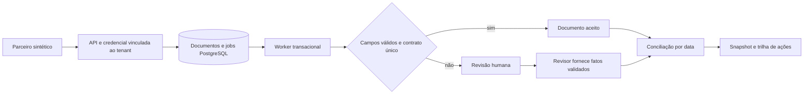

# Decisões de arquitetura

## 001 Monólito modular com processo worker separado

Status: aceito. A fronteira principal é entre receber trabalho e processá-lo. API, domínio puro, extração, persistência e worker ficam em módulos pequenos. PostgreSQL guarda a inbox e os resultados; não há motivo demonstrado para distribuir os módulos em microsserviços ou acrescentar Redis ao estado. Um único caso de uso define a conciliação.

## 002 Extração determinística e revisão explícita

Status: aceito. Dois layouts sintéticos conhecidos permitem demonstrar contratos e validações sem prometer OCR/LLM universal. Campos duplicados, ausentes e desconhecidos produzem códigos de problema. Não se executam instruções do documento. Texto bruto é temporário e limpo depois do processamento, inclusive após falha esgotada; a retenção é proporcional ao exercício, não uma política regulatória.

A identidade textual usa SHA256 por tenant. A referência de contrato validada tem unicidade canônica por tenant: outro layout do mesmo contrato exige revisão, em vez de abrir outra trilha financeira aceita. Uma implementação futura de versões documentais precisaria de modelo explícito de contratos e revisões.

## 003 Transações e concorrência

Status: aceito. A gravação do documento, job e primeira ação é atômica. Workers usam `FOR UPDATE SKIP LOCKED` no PostgreSQL; interpretação e atualização são uma única transação, sem efeito externo. Queda antes do commit deixa o trabalho pendente. Erro persistente consome três tentativas e encaminha para revisão. Conciliações travam o documento antes de atualizar pagamentos e snapshot. Constraints deduplicam referências e chaves. SQLite valida regras e fluxo sequencial; só o gate PostgreSQL comprova locks.

Isso não promete entrega exatamente uma vez a um sistema externo. A trilha de ações é um log no banco, consultável pela API, não um broker de eventos nem uma outbox publicada. Foram rejeitados Kafka/Celery/Redis neste recorte para evitar infraestrutura sem requisito.

## 004 Dinheiro e calendário

Status: aceito. Valores financeiros entram como strings com duas casas e são processados por Decimal/Numeric. Floats, valores não finitos e precisão excessiva são recusados. As parcelas esperadas são as informadas no contrato sintético; não há cálculo de juros, CET, capacidade de pagamento ou decisão de crédito. Datas mensais preservam o dia original com ajuste ao último dia do mês. Validação impede calendários fora do intervalo representável. Um oráculo de centavos inteiros oferece uma referência independente para a diferença de valores.

## 005 Segurança e operação proporcionais

Status: aceito. O tenant é derivado de credencial configurada pelo operador, não de JSON enviado pelo cliente. Papéis distinguem consulta, operação e revisão; acesso cruzado retorna 404. Configuração guarda hashes de tokens. Logs têm rota normalizada, ID de correlação e status, sem documentos, valores ou tokens. Métricas são protegidas e de cardinalidade limitada. Chaves locais não substituem SSO/rotação centralizada, e uma auditoria de ação/tenant não identifica pessoas individualmente.

Migrations são explícitas e versionadas; readiness consulta a tabela necessária. O mesmo código passa por CI com PostgreSQL antes de compor o material de evidência. Compose é local e usa usuários/portas restritos; deploy público e controles de produção ficam fora do estudo.
